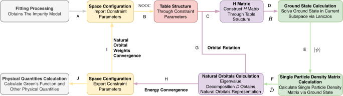
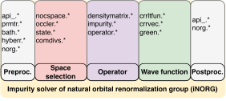

# Solver workflow

An iNORG calculation combines bath discretization, selection of a many-body space, orbital optimization, and evaluation of observables. In a DMFT calculation, this impurity workflow sits inside a separate lattice self-consistency loop.

## From hybridization to observables

The flowchart below shows how bath fitting leads to observables; the table explains its labels A–J.

{ style="background-color: white;" }

*Figure: Bath fitting defines the impurity model (A), and repeated solves in a selected space optimize the natural orbitals (B–I). After convergence, the solver evaluates physical quantities (J).*

| Step | Operation | Result |
| --- | --- | --- |
| A | Fit the target hybridization and supply the local interactions. | A finite Anderson impurity Hamiltonian. |
| B | Select configurations using natural orbital occupancy constraints. | The effective Hilbert space. |
| C | Record operator connections in the NORG-Table and insert the current coefficients. | A sparse Hamiltonian for that space. |
| D | Solve the projected Hamiltonian with Lanczos. | Ground-state energy and amplitudes. |
| E | Calculate $D_{\alpha\beta}=\langle\psi|c_\alpha^\dagger c_\beta|\psi\rangle$. | Single-particle density matrix. |
| F | Diagonalize the density matrix blocks. | New bath orbitals and natural occupations. |
| G | Rotate the bath orbitals and rebuild the Hamiltonian. | Repeat the inner orbital optimization loop. |
| H | Check the change in ground-state energy. | Once converged, retain occupations and the orbital transformation. |
| I | Check occupation stability and reconsider the selected space when needed. | A space appropriate to the optimized orbitals. |
| J | Calculate Green's functions and other observables. | Impurity output for analysis or another DMFT iteration. |

The paper expresses occupation stability through

$$
d=\sum_i|n_{i,\mathrm{last}}-n_{i,\mathrm{new}}|,
\qquad d\leq\Delta_d.
$$

This summarizes the method. In the current standalone code, the inner NORG loop updates orbitals within its constructed space. Mode 1 first runs a preliminary solve, uses its occupation weights to assign division sizes, and then constructs the final NORG problem. The actual inner occupation diagnostic is a root-mean-square change normalized by the total orbital count, and the stopping function also uses energy and iteration history. There is no standalone input keyword for the schematic tolerance $\Delta_d$.

<!-- iNORG paper: Overall workflow of iNORG, inorg.tex:304. Paper wording: separate energy and L1-occupation convergence loops. Code: src/api_edmft.cpp:47; src/api_edmft.cpp:49; src/api_edmft.cpp:374; src/api_edmft.cpp:423; src/norg.cpp:68; src/norg.cpp:92; src/norg.cpp:529. -->

<!-- iNORG paper: flowchart figure and caption, inorg.tex:310–327. The table follows the diagram's labels G (orbital rotation) and H (energy convergence), which differ from the enumerated steps in the paper text. -->

## How the run modes use this workflow

**One-shot mode (`mode 1`).** Read `Delta.inp`, fit the bath, and determine the orbital divisions. With `ful_pcl_sch 1`, a preliminary search compares particle-number sectors. With `ful_pcl_sch 0`, a preliminary solve still estimates occupations in the initial or restarted sector. Both preliminary paths use `cnooc` internally; the final solve uses the requested `NOOC`. The solver then writes $G_0$, $G$, and $\Sigma=G_0^{-1}-G^{-1}$. It does not feed that self-energy back into a lattice calculation.

<!-- src/api_edmft.cpp:19; src/api_edmft.cpp:32; src/api_edmft.cpp:47; src/api_edmft.cpp:70; src/api_edmft.cpp:374; src/api_edmft.cpp:390; src/occler.cpp:23. -->

**Bethe DMFT mode (`mode 0`).** Build a local lattice Green's function, obtain a bath target, fit it, and solve the resulting impurity. Update the self-energy and use it to construct the next lattice Green's function. A supplied `ose_hop` skips the first fit. The parser installs the `restrain` and `distribute` templates; the constraint type remains the compiled `phss_v2` default.

<!-- src/main.cpp:42; src/main.cpp:168; src/main.cpp:299; src/prmtr.cpp:82; src/dmft_bethe.cpp:60; src/dmft_bethe.cpp:73; src/dmft_bethe.cpp:96. -->

Mode 0 defaults to `pulay_mixing 0`: every iteration uses plain substitution (`se = seimp`). Pulay mixing is used only with `pulay_mixing 1`. It starts once an iteration after the first has self-energy error below `8e-3` and remains active thereafter. Mode 1 and the eDMFT path do not use this loop setting.

<!-- src/main.cpp:39; src/main.cpp:44; src/main.cpp:155; src/main.cpp:281; src/dmft_bethe.cpp:55; src/dmft_bethe.cpp:88; src/dmft_bethe.cpp:91 -->

### PH symmetry in the Bethe loop

Mode 0 defaults to `bath_ph_symm 1`, which requires `bethe_mu 0` and odd `fit_nbaths` entries. For $N_b=2h+1$, the bath fit optimizes $h+1$ hoppings and $h$ energy-pair parameters. It expands them into mirrored hoppings, opposite-energy pairs, and a middle energy fixed at zero. The [fitting page](hybridization-fitting.md#ph-symmetric-fit-in-mode-0) gives the equations. This keeps the half-filled bath PH symmetric, including when the zero-energy level decouples in an insulating solution.

The driver sets $\operatorname{Re}\Sigma_{aa}(i\omega_n)=0$ for the initial self-energy before storing it and for each computed impurity self-energy before writing it, evaluating the error, or updating the next input. The stored iterates and next self-energy remain projected, including the residuals and mixed self-energy when Pulay mixing is enabled. With `bath_ph_symm 0`, both the fit and this update remain unconstrained. Mode 1 and the eDMFT path retain the unconstrained fit. A seed bath that bypasses the first fit should already satisfy PH symmetry when the constraint is enabled.

<!-- src/main.cpp:154; src/main.cpp:283; src/main.cpp:286; src/prmtr.h:45; src/hyberr.h:123; src/bath.cpp:91; src/bath.cpp:215; src/dmft_bethe.cpp:60; src/dmft_bethe.cpp:89; src/dmft_bethe.cpp:53; src/dmft_bethe.cpp:74; src/dmft_bethe.cpp:96 -->

## Module map

The diagram below groups the modules by their role; the table maps these roles to source files and manual pages. The `api_.*` label is retained as shown in the paper; the current interface files are `api_edmft.cpp` and `api_edmft.h`, and `comdivs.*` is under `src/gen/`.

{ style="background-color: white;" }

*Figure: Module names appear above their roles in preprocessing, space selection, operators, wave functions, and postprocessing.*

<!-- iNORG paper: Organizational structure, inorg.tex:338–352. Module names checked against src/ and src/gen/; api_.* is the paper's interface label. -->

| Responsibility | Main source files | Manual page |
| --- | --- | --- |
| Inputs and outer calculation | `main.cpp`, `api_edmft.cpp`, `dmft_bethe.cpp` | [Quick start](../quickstart.md) |
| Bath discretization | `bath.cpp`, `hyberr.h`, `hyberr.cpp`, `gen/fitmrq.h` | [Hybridization fitting](hybridization-fitting.md) |
| Subspace and sector selection | `nocspace.cpp`, `occler.cpp` | [NOOC](nooc.md) |
| Configuration indices | `gen/onb.h`, `gen/comdivs.cpp`, `state.cpp` | [Encoding](encoding.md) |
| Operator connections and sparse matrices | `operator.cpp` | [Operators](operators.md) |
| Orbital optimization and density matrix | `norg.cpp`, `densitymatrix.cpp` | [NORG theory](../theory/norg.md) |
| Sparse eigensolve | `gen/lanczos.h` | [Ground state](ground-state.md) |
| Dynamical quantities | `crrltfun.cpp`, `crrvec.cpp`, `green.cpp` | [Green's functions](greens-functions.md) |

All file names in this table are relative to `src/`. C++17 supplies the implementation language, MPI distributes work, and MKL supplies numerical kernels. Interface directories under `api/` support integration with external workflows; they do not add further standalone `mode` values.

## Check each level of convergence

Inspect the bath fit, the inner eigenproblem, the orbital optimization, and, for mode 0, the outer self-consistency separately. Increasing a bath size can change both fit accuracy and the selected many-body space. Increasing a Lanczos dimension does not relax NOOC constraints.

The message `THE NORG CONVERGED` is also printed when the inner loop reaches its iteration limit. Inspect the preceding energy and occupation history.

<!-- src/norg.cpp:68; src/norg.cpp:103; src/dmft_bethe.cpp:394. -->

## References

- J.-M. Wang et al., *iNORG: An open-source quantum impurity solver package based on the natural orbitals renormalization group*, “Overall workflow of iNORG.”
