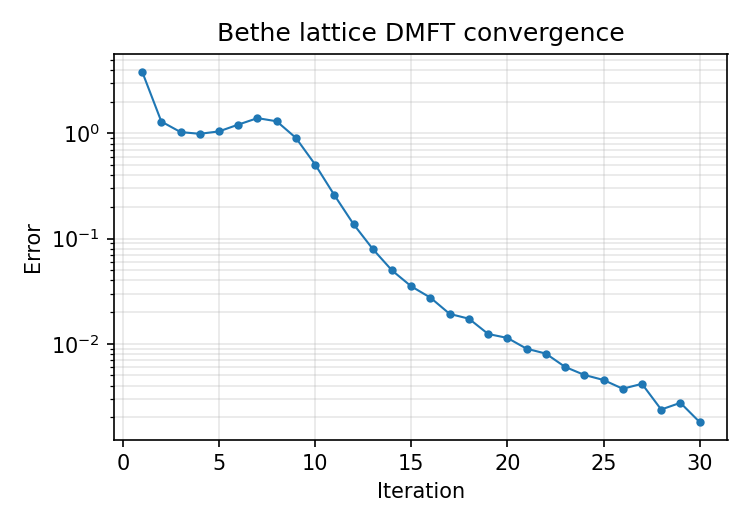
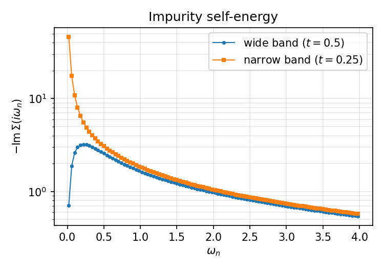

# Multi-orbital Bethe lattice DMFT

This example is in `tutor/2_Multi-orbital_model_on_Bethe_lattice_with_DMFT`. It solves a two-orbital lattice model through a local impurity problem with a discrete bath. Each band has a semicircular noninteracting density of states with half-bandwidth $2|t_a|$. The density-density interactions are an intra-orbital $U$ and an inter-orbital $U'$, with zero Hund coupling in this mode.

The solver uses a half-filling shift in the impurity Hamiltonian. For two bands with zero Hund coupling, this shift is $U/2+U'$. Equivalently, the local interaction can be written, up to a constant, using $(n_{a\uparrow}-1/2)(n_{a\downarrow}-1/2)$ and $(n_1-1)(n_2-1)$. The default PH-symmetric fit requires a zero chemical-potential offset.

<!-- src/impurity.cpp:270; src/impurity.cpp:306; src/prmtr.cpp:50; src/main.cpp:154; src/main.cpp:283; src/dmft_bethe.cpp:256 -->

The Bethe self-consistency relation is $\Delta_a(z)=t_a^2G_{\mathrm{loc},a}(z)$. The active loop constructs the bath target from the current local Green's function and self-energy, fits a finite bath, solves the impurity, and updates the self-energy.

<!-- src/main.cpp:42; src/dmft_bethe.cpp:61; src/dmft_bethe.cpp:70; src/dmft_bethe.cpp:73; src/dmft_bethe.cpp:162; src/dmft_bethe.cpp:211 -->

!!! warning "Convergence needs inspection"

    With `bath_ph_symm 0`, an unconstrained fit can break particle-hole symmetry and the DMFT loop may not converge. The supplied input uses the default `bath_ph_symm 1`. Inspect the full iteration history before using the results.

## Physics and relation to Example 2

This is **Example 2** in the iNORG paper. The two hopping amplitudes produce a wide and a narrow band. Local intra-orbital and inter-orbital repulsions couple their charge fluctuations. DMFT represents the environment of each band by a bath whose hybridization is updated from the interacting lattice Green's function. The calculation therefore tests both the impurity solver and the outer self-consistency procedure.

The energy unit is a common model hopping scale. With the supplied `bethe_t`, the narrow-band hopping is half the wide-band hopping. Use the orbital-resolved Green's functions, self-energies, and occupations to inspect the distinct responses of the two bands. The input by itself does not establish a metallic, insulating, or orbital-selective phase.

The paper and the checked-in example both use $U=3$ and $U'=2.7$, so $U-U'=0.3$. Their bath counts, initial degeneracy settings, and division templates differ. The paper values below are **as reported in the paper**, not new reference results:

| Setting | As reported in the paper, Example 2 | Checked-in tutorial |
| --- | --- | --- |
| `fit_nbaths` | `[7, 7, 7, 7]` | `[5, 5, 5, 5]` |
| `bethe_u` | `3.0` | `3` |
| `bethe_uprim` | `2.7` | `2.7` |
| `pred_gs_deg` | `2` | `1` |
| `distribute` | `[1, 0, 1, 2, 1, 2, 1, 0]` | `[1, 0, 0, 2, 1, 2, 0, 0]` |

The walkthrough uses the checked-in values. A change to the bath count must be accompanied by a consistent division template and any seed bath. The [NOOC page](../implementation/nooc.md) explains these counts. The compiled mode-0 constraint is already `phss_v2`; the parser does not read the `NOOC` line listed in the paper. Likewise, the current chemical-potential reset and `pred_gs_deg` branch behavior take precedence over the paper's parameter descriptions.

<!-- iNORG paper: Examples / Example 2, inorg.tex:986. Actual example: tutor/2_Multi-orbital_model_on_Bethe_lattice_with_DMFT/PARAMS.norg:4; tutor/2_Multi-orbital_model_on_Bethe_lattice_with_DMFT/PARAMS.norg:5; tutor/2_Multi-orbital_model_on_Bethe_lattice_with_DMFT/PARAMS.norg:6; tutor/2_Multi-orbital_model_on_Bethe_lattice_with_DMFT/PARAMS.norg:8; tutor/2_Multi-orbital_model_on_Bethe_lattice_with_DMFT/PARAMS.norg:11. Parser/default differences: src/main.cpp:168; src/prmtr.cpp:82; src/prmtr.cpp:129; src/densitymatrix.cpp:102. -->

## Input parameters, line by line

The supplied `PARAMS.norg` is:

```text
mode         0                           # "0" for multi-orbital Bethe lattice DMFT iteration; "1" for one-shot impurity model solution.
bethe_mu     0                           # Chemical potential for the Bethe lattice.
bethe_band   2                           # Number of orbitals per site in the Bethe lattice.
bethe_t      [0.5, 0.25]                 # Hopping coefficients for each orbital in one site.
fit_nbaths   [5, 5, 5, 5]                # Number of baths used for each irreducible representation (good quantum number) set
bethe_u      3                           # Intra-orbital interaction coefficient.
bethe_uprim  2.7                         # Inter-orbital interaction coefficient.
pred_gs_deg  1                           # Predicted ground state degeneracy; if set to 0, ground state degeneracy is not checked to speed up calculation
NOOC         phss_v2                     # Type of natural orbital occupancy constraint (NOOC).
restrain     [0, -2, -3, -4, 0, 4, 3, 2] # Details of NOOC
distribute   [1,  0,  0,  2, 1, 2, 0, 0] # Template for the positions of specific orbitals in NOOC
```

<!-- tutor/2_Multi-orbital_model_on_Bethe_lattice_with_DMFT/PARAMS.norg:1 -->

| Line | Setting | Effect |
| --- | --- | --- |
| 1 | `mode 0` | Selects the standalone Bethe DMFT loop. Internally the driver chooses the self-energy update variant. <!-- src/main.cpp:39; src/main.cpp:42 --> |
| 2 | `bethe_mu 0` | Sets the zero chemical-potential offset required by the default `bath_ph_symm 1`. A nonzero value is an error with this default. <!-- src/main.cpp:170; src/main.cpp:283 --> |
| 3 | `bethe_band 2` | Uses two spatial orbitals, or four spin-orbital sets. <!-- src/main.cpp:246 --> |
| 4 | `bethe_t [0.5, 0.25]` | Sets the two hopping scales in a common model energy unit. <!-- src/main.cpp:190; src/dmft_bethe.cpp:256 --> |
| 5 | `fit_nbaths [5, 5, 5, 5]` | Assigns five bath orbitals to each spin-orbital set. All entries are odd, as required by `bath_ph_symm 1`. Spin pairs share fitted parameters. <!-- src/main.cpp:204; src/main.cpp:286; src/bath.cpp:25; src/bath.cpp:455 --> |
| 6 | `bethe_u 3` | Sets the intra-orbital repulsion to $U=3$. <!-- src/main.cpp:200; src/impurity.cpp:271 --> |
| 7 | `bethe_uprim 2.7` | Sets the inter-orbital repulsion to $U'=2.7$, giving $U-U'=0.3$. <!-- src/main.cpp:202; src/main.cpp:253; src/dmft_bethe.cpp:21 --> |
| 8 | `pred_gs_deg 1` | Starts with one stored ground state and selects the explicit degeneracy-aware density-matrix branch. Detected degeneracy can subsequently increase. <!-- src/main.cpp:248; src/densitymatrix.cpp:102; src/operator.cpp:331 --> |
| 9 | `NOOC phss_v2` | This line is ignored by the mode-0 parser. The compiled constraint is already `phss_v2`. <!-- src/main.cpp:168; src/main.cpp:240; src/prmtr.cpp:82 --> |
| 10 | `restrain [0, -2, -3, -4, 0, 4, 3, 2]` | Sets the eight division constraints. `phss_v2` limits cumulative hole-plus-particle excitations across paired bath divisions. <!-- src/main.cpp:214; src/nocspace.cpp:95; src/nocspace.cpp:122 --> |
| 11 | `distribute [1, 0, 0, 2, 1, 2, 0, 0]` | Places six orbitals in each set's eight divisions: one impurity and five bath orbitals. The same row is used for all four sets. <!-- src/main.cpp:297; src/main.cpp:317; src/main.cpp:324 --> |

The input omits `bath_ph_symm`, so its mode-0 default of `1` applies. At half filling, the Bethe problem is PH symmetric. The constrained fit uses mirrored hoppings, opposite-energy bath pairs, and a middle level fixed at zero. In an insulating solution, that level decouples; an unconstrained fit can move it away from zero, change the impurity ground state, and stop convergence. The constraint prevents this symmetry breaking. The driver also sets $\operatorname{Re}\Sigma_{aa}(i\omega_n)=0$ for the initial self-energy before storing it and for each computed impurity self-energy before writing it, evaluating the error, or updating the next input. The stored iterates and next input therefore remain projected, including Pulay residuals when mixing is enabled. See the [PH-symmetric fit](../implementation/hybridization-fitting.md#ph-symmetric-fit-in-mode-0).

<!-- src/main.cpp:154; src/main.cpp:280; src/hyberr.h:123; src/bath.cpp:215; src/dmft_bethe.cpp:53; src/dmft_bethe.cpp:74 -->

The input also omits `pulay_mixing`, so its mode-0 default of `0` applies. Every iteration uses plain substitution (`se = seimp`). Pulay mixing is used only with `pulay_mixing 1`; it starts once an iteration after the first has self-energy error below `8e-3` and remains active thereafter.

<!-- src/main.cpp:155; src/main.cpp:183; src/main.cpp:281; src/dmft_bethe.cpp:88; src/dmft_bethe.cpp:91 -->

The full [parameter reference](../parameters.md) explains the division layout and defaults. This mode does not read `beta`; its mesh uses $\beta=50\pi$ and 8193 positive Matsubara frequencies. This controls frequency sampling for the ground-state calculation.

<!-- src/prmtr.cpp:33; src/prmtr.cpp:35; src/prmtr.cpp:249 -->

## Other inputs and bath format

Only `PARAMS.norg` is required for a fresh run. Mode 0 does not read `Delta.inp`. Without restart inputs, it starts from the noninteracting lattice Green's function and a generated bath seed.

<!-- src/dmft_bethe.cpp:33; src/dmft_bethe.cpp:47; src/dmft_bethe.cpp:50; src/bath.cpp:29 -->

An optional `ose_hop` file supplies a bath. For this example it must contain two blocks, `set[0]` and `set[1]`, each with exactly five hybridization amplitudes under `the` and five bath energies under `epi`. The layout is:

```text
set[0]
the
V1 V2 V3 V4 V5
epi
epsilon1 epsilon2 epsilon3 epsilon4 epsilon5
set[1]
the
V1 V2 V3 V4 V5
epi
epsilon1 epsilon2 epsilon3 epsilon4 epsilon5
```

Replace the symbols with real numbers in the same energy unit as the model. `the` holds impurity-bath hopping amplitudes $V_j$; `epi` holds bath energies $\epsilon_j$. There is one block per spatial band, since the two spins share a bath. The reader consumes fixed numbers of whitespace-separated values and does not validate labels or row lengths. Do not include comments in this file.

<!-- src/bath.cpp:329; src/bath.cpp:361; src/bath.cpp:448; src/impurity.cpp:79 -->

If `ose_hop` exists, the first iteration uses that bath directly and skips fitting. Later iterations fit the updated hybridization. Use a seed from a compatible calculation. With the default `bath_ph_symm 1`, supply paired energies, mirrored hoppings, and a zero middle energy in the seed as well.

Optional `mb.gfloc` and `mb.seimp` supply a local Green's function and self-energy. Their layout is the mode-0 frequency-table format, including its header. Use a consistent pair from the same iteration and model, with matching band count and mesh; mode 0 does not create files with these unprefixed restart names automatically.

<!-- src/dmft_bethe.cpp:33; src/dmft_bethe.cpp:48; src/dmft_bethe.cpp:60; src/green.cpp:9 -->

## Run

From the repository root, after [installation](../installation.md):

```bash
cd tutor/2_Multi-orbital_model_on_Bethe_lattice_with_DMFT
mpiexec -n <N> ../../inorg > run.log 2>&1
```

Replace `<N>` with the number of physical cores on your machine (at least 2). For reference, this example takes about 2 hours on 24 cores. Save earlier output before rerunning: iteration filenames start again from the beginning, while the text logs append.

## Inspect the output

`log.parameters.txt` records the derived parameters. `log.txt` gives one line for the initial state and each self-energy-error update. Track that error alongside the occupations and self-energy curves across iterations. Finishing the process is not proof of physical convergence: the loop has both an iteration cap and stopping rules based on the recent error history.

<!-- src/dmft_bethe.cpp:24; src/dmft_bethe.h:60; src/dmft_bethe.cpp:57; src/dmft_bethe.cpp:394 -->

For iteration `NNN`, inspect:

- `zicNNN.mb.hb.txt` and `zicNNN.mb.hb-fit.txt`: target and fitted hybridization. The target file is absent in the first iteration when a seed bath bypasses fitting.
- `zicNNN.ose_hop.txt` and `zicNNN.h0.txt`: fitted bath and stored one-body matrix. The bath file is written only when fitting occurs.
- `zicNNN.mb.g0imp.txt`, `zicNNN.mb.gfimp.txt`, and `zicNNN.mb.seimp.txt`: noninteracting impurity Green's function, interacting Green's function, and self-energy.
- `zicNNN.mb.gfloc.txt`: local lattice Green's function after the self-energy update.
- `zicNNN.nmat.txt`: impurity occupations, followed by correlation blocks. The double-occupancy block and quantities derived from it are currently unreliable.

<!-- src/dmft_bethe.cpp:61; src/dmft_bethe.cpp:63; src/dmft_bethe.cpp:65; src/dmft_bethe.cpp:67; src/dmft_bethe.cpp:70; src/dmft_bethe.cpp:71; src/dmft_bethe.cpp:96 -->

The initial lattice file is `zic000.mb.g0loc.txt` for a fresh run. Frequency tables place all real parts first, then a repeated frequency column and all imaginary parts. The [output reference](../output-files.md) gives exact layouts and explains which files can be reused as inputs.

## References

- A. Georges et al. (1996), “Dynamical mean-field theory of strongly correlated fermion systems and the limit of infinite dimensions,” *Reviews of Modern Physics* **68**, 13–125.
- J.-M. Wang et al., *iNORG: An open-source quantum impurity solver package based on the natural orbitals renormalization group*, “Example 2: Multi-orbital DMFT calculation on Bethe lattice.”

## Reference output

The supplied reference output in `tutor/2_Multi-orbital_model_on_Bethe_lattice_with_DMFT/important_output/` shows the state after iteration 30 for illustration. It contains nine `zic030.*` files, `log.parameters.txt`, and `log.txt` and `run.log` cut after iteration 30. The last recorded error is about $1.8\times10^{-3}$. The run used the unchanged tutorial input ($U=3$, $U'=2.7$), the defaults `bath_ph_symm 1` and `pulay_mixing 0`, and 36 MPI ranks. The figures below were generated from these iteration-30 reference files.

A full run continues until the code's stopping rule is met, subject to the iteration limit. In the reference run, the error first fell below $10^{-4}$ at iteration 61 ($8.57\times10^{-5}$), and the code stopped after iteration 62.

<!-- tutor/2_Multi-orbital_model_on_Bethe_lattice_with_DMFT/important_output/log.txt:31; tutor/2_Multi-orbital_model_on_Bethe_lattice_with_DMFT/important_output/run.log:3443; tutor/2_Multi-orbital_model_on_Bethe_lattice_with_DMFT/important_output/log.parameters.txt:2; tutor/2_Multi-orbital_model_on_Bethe_lattice_with_DMFT/PARAMS.norg:6; tutor/2_Multi-orbital_model_on_Bethe_lattice_with_DMFT/PARAMS.norg:7; src/main.cpp:154; src/main.cpp:155; src/dmft_bethe.cpp:57; src/dmft_bethe.cpp:394; src/dmft_bethe.cpp:396 -->

### Convergence

The figure shows the error column of the supplied `log.txt` through iteration 30. Each spin-orbital stays at half filling, $n = 0.5$, within numerical precision in every iteration.



### Self-energy

The figure shows $-\mathrm{Im}\,\Sigma(i\omega_n)$ of the two orbitals from `zic030.mb.seimp.txt` (columns 5 and 6). Compared with iteration 61 of the reference run, the iteration-30 self-energy differs by at most about 1% for the wide band and 0.4% for the narrow band over $\omega_n\leq2$. The physical picture is the same orbital-selective Mott phase. For the narrow band ($t = 0.25$), $-\mathrm{Im}\,\Sigma$ grows without bound as $\omega_n \to 0$: this orbital is a Mott insulator. For the wide band ($t = 0.5$), $-\mathrm{Im}\,\Sigma$ goes back toward zero at low frequency: this orbital stays metallic.

<!-- tutor/2_Multi-orbital_model_on_Bethe_lattice_with_DMFT/important_output/zic030.mb.seimp.txt:1 -->



### What iNORG found in this model

The same type of model, a half-filled two-orbital Hubbard model, was studied with iNORG as the impurity solver in its orbital-selective Mott phase. The low-energy excitations are not explained by the usual holon-doublon bound state. They are interband Kondo-like bound states: a Kondo-like state in the wide band bound to a doublon in the narrow band. When the two bandwidths come close, anomalous forms of these states appear in the metallic wide band. For the full analysis, see J.-M. Wang *et al.*, *Low-energy interband Kondo bound states in orbital-selective Mott phases*, [Phys. Rev. B **111**, 155107 (2025)](https://journals.aps.org/prb/abstract/10.1103/PhysRevB.111.155107).
