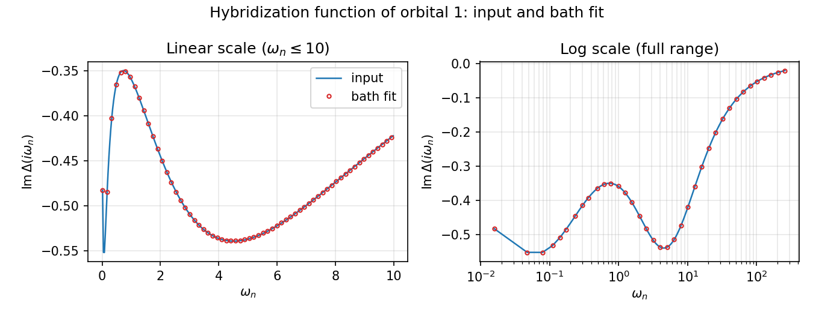
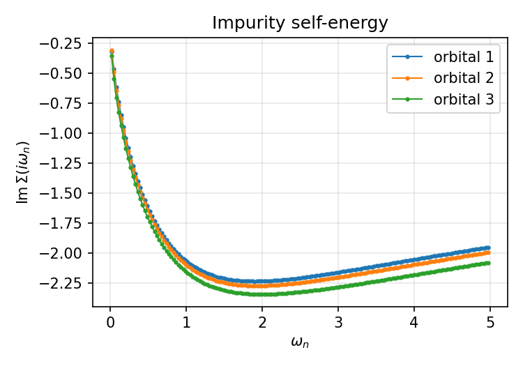

# One-shot multi-orbital impurity solution

This example is in `tutor/1_Single-impurity_Anderson_model_with_multiple_orbitals`. It solves a three-orbital single-impurity Anderson model for a fixed input hybridization $\Delta_a(i\omega_n)$. The bath fit replaces that continuous input with discrete levels:

$$
H_0=\sum_{a\sigma}E_{d,a}n_{a\sigma}
 +\sum_{aj\sigma}\epsilon_{aj}c^\dagger_{aj\sigma}c_{aj\sigma}
 +\sum_{aj\sigma}\left(V_{aj}d^\dagger_{a\sigma}c_{aj\sigma}+\mathrm{h.c.}\right),
\qquad
\Delta_a(z)=\sum_j\frac{|V_{aj}|^2}{z-\epsilon_{aj}}.
$$

<!-- src/impurity.cpp:24; src/impurity.cpp:76; src/impurity.cpp:237; src/bath.cpp:445 -->

The interaction is density-density only. In the three-band interaction builder, the input `U` and `J` give the coefficients

$$
U_{\mathrm{intra}}=U+\frac{8}{7}J,\qquad
U_{\mathrm{inter}}=U-\frac{328}{819}J,\qquad
J_{\mathrm{eff}}=\frac{632}{819}J.
$$

Opposite-spin electrons in different orbitals interact through $U_{\mathrm{inter}}$; equal-spin electrons through $U_{\mathrm{inter}}-J_{\mathrm{eff}}$. Thus the input `U` is not itself the final intra-orbital repulsion. No spin-flip or pair-hopping terms are enabled by changing `CoulombF`.

<!-- src/impurity.cpp:468; src/impurity.cpp:474; src/impurity.cpp:476; src/impurity.cpp:480; src/api_edmft.cpp:138 -->

Mode 1 performs one impurity solution after its preliminary sector search and bath fit. It does not update a lattice hybridization self-consistently.

## Physics and relation to Example 1

This is **Example 1** in the iNORG paper. The three local orbitals interact while exchanging electrons with the prescribed environment. The small differences among the impurity levels distinguish the orbital channels. Their hybridization functions determine how each channel couples to the bath; the interaction parameters then determine the correlated response.

NORG rotates the noninteracting bath orbitals to separate active orbitals from nearly full or nearly empty ones. Occupancy constraints limit the latter groups while leaving the impurity basis fixed. The resulting impurity Green's function and self-energy are the quantities an external DMFT driver would use to update the environment. Keeping the input hybridization fixed here isolates the impurity-solving step.

The paper motivates the supplied sparse `fit_points` using the discrete Lehmann representation. As reported in the paper, the grid selection uses $E_{\mathrm{uv}} = 10$, $\beta = 200$, and relative tolerance $10^{-6}$. These describe the origin of the selected rows; the input reader accepts an explicit list of row indices and does not generate this grid. `beta` sets the sampling mesh for this ground-state calculation.

Read [the impurity model](../theory/impurity-model.md), [bath fitting](../implementation/hybridization-fitting.md), and [NOOC input rules](../implementation/nooc.md) alongside the input walkthrough below.

<!-- iNORG paper: Examples / Example 1, inorg.tex:912, including fit_points description. Paper wording calls beta an inverse temperature; the implementation solves ground states (src/densitymatrix.cpp:100) on the mesh from src/prmtr.cpp:249. Paper wording calls deg_idx degeneracies; the code uses group labels (src/api_edmft.cpp:160). Paper wording calls pred_gs_deg an expected degeneracy; actual branch selection is src/densitymatrix.cpp:102. -->

## Input parameters, line by line

The supplied `PARAMS.norg`, with comments omitted, is:

```text
mode          1
Ed            [-11.61347089 -11.62251229 -11.63870539]
deg_idx       [1, 2, 3]
U             8.0
J             0.8
CoulombF      'Ising'
beta          200.0
fit_points    [0, 1, 2, 3, 4, 5, 7, 10, 13, 18, 24, 33, 46, 60, 81, 108, 146, 192, 252, 325, 439, 658, 1088, 2164, 3780]
fit_nbaths    [11, 11, 11, 11, 11, 11]
NOOC          phss_v2
restrain      [0, -2, -3, -4, 0, 4, 3, 2]
pred_gs_deg   2
ful_pcl_sch   1
weight_nooc   [1e-05, 1e-05, 1e-05, 1e-05, 1e-05]
weight_freze  [1e-07, 1e-07, 1e-07, 1e-07, 1e-07]
```

<!-- tutor/1_Single-impurity_Anderson_model_with_multiple_orbitals/PARAMS.norg:1 -->

| Line | Setting | Effect |
| --- | --- | --- |
| 1 | `mode 1` | Selects the one-shot solver path. <!-- src/main.cpp:44 --> |
| 2 | `Ed [...]` | Gives the three impurity levels in eV, with the energy reference supplied by the input. <!-- src/api_edmft.cpp:456; src/api_edmft.cpp:161 --> |
| 3 | `deg_idx [1, 2, 3]` | Creates three distinct spatial-orbital groups. Each group is spin-degenerate because `magnetic` defaults to zero. <!-- src/api_edmft.cpp:17; src/api_edmft.cpp:467; src/api_edmft.cpp:160 --> |
| 4 | `U 8.0` | Supplies the Coulomb parameter used in the coefficient formulas above, in eV. <!-- src/api_edmft.cpp:495; src/impurity.cpp:469 --> |
| 5 | `J 0.8` | Supplies the exchange parameter used in those formulas, in eV. <!-- src/api_edmft.cpp:480; src/impurity.cpp:471 --> |
| 6 | `CoulombF 'Ising'` | Selects the supported density-density interaction token. The single quotes are part of the token. <!-- src/api_edmft.cpp:138; src/api_edmft.cpp:483 --> |
| 7 | `beta 200.0` | Sets the Matsubara mesh with $\beta=200\,\mathrm{eV}^{-1}$. It is a sampling parameter for a ground-state solve, not a thermal-ensemble calculation. <!-- src/api_edmft.cpp:149; src/api_edmft.cpp:492; src/prmtr.cpp:249 --> |
| 8 | `fit_points [...]` | Selects the listed 25 zero-based frequency-row indices for the bath fit. The solver still reads the full frequency file. <!-- src/api_edmft.cpp:521; src/prmtr.cpp:242; src/hyberr.cpp:42; src/green.cpp:236 --> |
| 9 | `fit_nbaths [11, ...]` | Requests eleven bath sites in each of six spin-orbital sets. The example has no `ose_hop`; the solver warns and fits from its generated initial bath. <!-- src/api_edmft.cpp:543; src/prmtr.cpp:135 --> |
| 10 | `NOOC phss_v2` | Uses cumulative hole-plus-particle constraints for paired bath divisions. <!-- src/api_edmft.cpp:489; src/nocspace.cpp:95 --> |
| 11 | `restrain [...]` | Supplies the eight division limits. Division sizes are derived automatically in this mode. <!-- src/api_edmft.cpp:554; src/api_edmft.cpp:423 --> |
| 12 | `pred_gs_deg 2` | Sets the integer eigensolve selector to `2`. The current code enables its explicit multi-state branch only for `1`; this value does not impose twofold degeneracy. <!-- src/api_edmft.cpp:498; src/api_edmft.cpp:291; src/densitymatrix.cpp:102; src/densitymatrix.cpp:111 --> |
| 13 | `ful_pcl_sch 1` | Searches particle-number sectors before the final solve. <!-- src/api_edmft.cpp:507; src/api_edmft.cpp:374 --> |
| 14 | `weight_nooc [1e-05, ...]` | Sets the per-band threshold for constrained bath divisions. Only the first three entries are needed for this three-band example. <!-- src/api_edmft.cpp:510; src/api_edmft.cpp:416 --> |
| 15 | `weight_freze [1e-07, ...]` | Sets the smaller per-band threshold for the outer bath divisions. The spelling is `freze`. <!-- src/api_edmft.cpp:532; src/api_edmft.cpp:415 --> |

See the [parameter reference](../parameters.md) for defaults, aliases, and the precise relation between constraints and occupation weights.

## Delta.inp

`Delta.inp` supplies the diagonal hybridization on the positive fermionic Matsubara mesh. For this example, each data row has seven whitespace-separated columns:

```text
omega_n  ReDelta_1  ImDelta_1  ReDelta_2  ImDelta_2  ReDelta_3  ImDelta_3
```

Here $\omega_n=(2n+1)\pi/\beta$, with $n=0,1,\ldots$. Frequencies and hybridization values use eV in this example. The supplied file has 8193 rows, matching the default `nmesh`, and its frequencies match `beta 200.0`. In a general spin-degenerate input, there is one real/imaginary pair per degeneracy group, in consecutive group order.

<!-- tutor/1_Single-impurity_Anderson_model_with_multiple_orbitals/Delta.inp:1; tutor/1_Single-impurity_Anderson_model_with_multiple_orbitals/Delta.inp:8193; src/prmtr.cpp:35; src/prmtr.cpp:249; src/green.cpp:221; src/green.cpp:228 -->

The reader allows initial lines beginning with `#`. After the first numeric row, supply uninterrupted numeric rows with no header or comments. Avoid blank lines before the first row. The reader consumes each frequency value but uses row position to assign the internal mesh; it does not check that your frequencies match `beta`. Do not replace the file with only the sparse `fit_points` rows.

<!-- src/green.cpp:214; src/green.cpp:222; src/green.cpp:236; src/green.cpp:253 -->

## ose_hop

`ose_hop` is an optional starting bath. The example does not supply one, so the first run fits from the generated initial bath. When the file exists, mode 1 reads it before fitting and then overwrites it with the fitted bath. Each spatial orbital has a block, labeled `set[0]`, `set[1]`, and `set[2]` for this example. The two spin channels share each block.

For each block, the required layout with eleven baths is:

```text
set[0]
the
V1 V2 V3 V4 V5 V6 V7 V8 V9 V10 V11
epi
epsilon1 epsilon2 epsilon3 epsilon4 epsilon5 epsilon6 epsilon7 epsilon8 epsilon9 epsilon10 epsilon11
```

Use real numeric values for the symbols, then repeat the block for the other two orbitals. `the` contains impurity-bath hopping amplitudes $V_j$; `epi` contains bath energies $\epsilon_j$. Both are energies. The reader expects the exact count in every row and does not validate the block labels or reject a wrong count.

<!-- src/api_edmft.cpp:32; src/api_edmft.cpp:35; src/bath.cpp:329; src/bath.cpp:361; src/impurity.cpp:79; src/impurity.cpp:88 -->

## Run

For a fresh checkout, start at the repository root:

```bash
cd tutor/1_Single-impurity_Anderson_model_with_multiple_orbitals
mpiexec -n <N> ../../inorg > run.log 2>&1
```

A missing `ose_hop` produces a warning and leaves the generated initial bath in place. Fitting still runs. On later runs, keep the newly fitted file only if it matches the current bath counts. Replace `<N>` with the number of physical cores on your machine (at least 2). For reference, this example takes about 2 hours on 24 cores. Preserve old numerical output before rerunning.

<!-- src/bath.cpp:29; src/bath.cpp:363; src/api_edmft.cpp:34; src/main.cpp:21 -->

## Inspect the output

First compare `hb_read.txt` with `hb_fit.txt`, particularly at the low frequencies used by the fit. `h0.txt` gives fit diagnostics and the stored one-body Hamiltonian; `ose_hop` contains the fitted bath.

`g0imp.txt`, `Gf.out`, and `Sig.out` contain $G_0$, $G$, and $\Sigma=G_0^{-1}-G^{-1}$. They use the same seven-column layout as `Delta.inp` for this example, without a header. A missing `Sig.out` warning is expected on the first run because the solver attempts to compare with the previous self-energy.

<!-- src/api_edmft.cpp:29; src/api_edmft.cpp:39; src/api_edmft.cpp:44; src/api_edmft.cpp:62; src/api_edmft.cpp:68; src/api_edmft.cpp:70; src/api_edmft.cpp:79; src/green.cpp:188 -->

`nmat.txt` begins with spin-orbital occupations and their totals. Its double-occupancy and derived correlation blocks are [not reliable](../known-limitations.md#double-occupancy-output). `log.norg` appends a summary with the self-energy change, particle-number sectors, bath-fit errors, and occupations. That self-energy change compares two invocations; it is not an internal DMFT convergence test.

`edmft_back_up` stores an iteration counter and particle numbers for subsequent invocations, even in this standalone mode. For an independent calculation, start from a clean run directory containing only the chosen inputs. See the [output reference](../output-files.md) for all layouts and overwrite behavior.

<!-- src/api_edmft.cpp:46; src/api_edmft.cpp:55; src/api_edmft.cpp:314; src/api_edmft.cpp:620; src/api_edmft.h:98 -->

## References

- J. Kaye, K. Chen, and O. Parcollet (2022), “Discrete Lehmann representation of imaginary time Green's functions,” *Physical Review B* **105**, 235115.
- J. Kaye, K. Chen, and H. U. R. Strand (2022), “libdlr: Efficient imaginary time calculations using the discrete Lehmann representation,” *Computer Physics Communications* **280**, 108458.
- J.-M. Wang et al., *iNORG: An open-source quantum impurity solver package based on the natural orbitals renormalization group*, “Example 1: One-shot solution of multi-orbital impurity problem in DMFT.”

## Reference output

The reference results are in `tutor/1_Single-impurity_Anderson_model_with_multiple_orbitals/important_output/`: `Sig.out`, `Gf.out`, `g0imp.txt`, `hb_read.txt`, `hb_fit.txt`, `h0.txt`, `nmat.txt`, the fitted `ose_hop`, `log.norg`, and `run.log`. In `hb_read.txt`, `hb_fit.txt` and `Sig.out` the columns are $\omega_n$, then the real and imaginary parts for orbitals 1, 2 and 3.

### Hybridization fit

The figure compares $\mathrm{Im}\,\Delta(i\omega_n)$ of orbital 1 read from `Delta.inp` (`hb_read.txt`, line) with the hybridization of the fitted bath of eleven sites (`hb_fit.txt`, circles). The left panel uses a linear frequency axis up to $\omega_n = 10$; the right panel uses a logarithmic axis over the full range. The other two orbitals give almost the same curves. The finite bath follows the input over the full frequency range.



### Self-energy

The figure shows $\mathrm{Im}\,\Sigma(i\omega_n)$ of the three orbitals from `Sig.out`. This is the self-energy that the solver returns to the DFT+DMFT loop.


